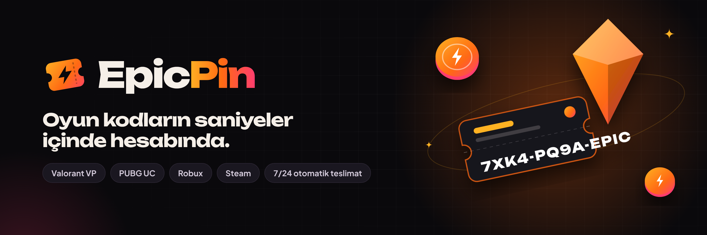

# EpicPin

Oyun e-pin ve dijital kod mağazası. Next.js 15, PostgreSQL ve Tailwind CSS ile yapıldı; Vercel'e tek tıkla yüklenecek şekilde hazırlandı.



## Özellikler

**Kullanıcı**
- Kayıt olma, giriş yapma
- Sepet ve bakiyeyle satın alma
- Otomatik teslimat: stoktaki kod ödeme anında Siparişlerim sayfasında görünür
- İade talebi, favoriler, bakiye hareketleri
- Bakiye yükleme (Havale/EFT, Papara, kripto vb. bildirim sistemi)
- Destek talebi açma ve mesajlaşma

**Yönetim paneli (`/admin`)**
- İlan ekleme/düzenleme, kapak fotoğrafı, eski fiyatla indirimli gösterme
- Otomatik teslimat için stoğa kod ekleme (her satıra bir kod)
- Kategori, banner (ana sayfa kayan alanı), duyuru ve blog yönetimi
- Üye ve yönetici ekleme, bakiye düzenleme, hesap askıya alma
- Ödeme yöntemleri, bakiye bildirimi onayı, iade onayı
- Manuel teslimatlı siparişleri teslim etme
- Site ayarları: logo, favicon, site adı, üst kampanya şeridi, sosyal medya
- Destek talepleri
- Kuponlar: yüzde veya sabit indirim, alt limit, kullanım limiti, son kullanma tarihi
- Bakım modu ve açılış penceresi (popup kampanya)
- Sık sorulanlar yönetimi, WhatsApp destek butonu, canlı satış şeridi
- Sipariş detayı ve yöneticiden iade (kodları stoğa geri alma seçeneğiyle)
- Siparişleri ve üyeleri Excel'e (CSV) aktarma
- İlan kopyalama, işlem kayıtları (hangi yönetici ne yaptı)

## Vercel'e yükleme

1. Bu repoyu GitHub'a yükle (zaten yüklüyse geç).
2. [vercel.com/new](https://vercel.com/new) adresinde repoyu seç ve **Deploy** de.
3. Vercel'de projenin **Storage** sekmesinden **Neon (Postgres)** veritabanı oluştur ve projeye bağla. Bölge olarak **Frankfurt (eu-central-1)** seç: site de Frankfurt'ta çalışacak şekilde ayarlı (`vercel.json`), ikisi aynı yerde olunca sayfalar çok daha hızlı açılır. `DATABASE_URL` otomatik eklenir.
4. **Settings → Environment Variables** bölümüne şunları ekle:

   | Değişken | Açıklama |
   | --- | --- |
   | `AUTH_SECRET` | (Önerilir) En az 16 karakterlik rastgele bir metin. Oturumları şifreler; girilmezse veritabanı adresinden güvenli bir anahtar türetilir. |
   | `ADMIN_EMAIL` | İlk yönetici hesabının e-postası |
   | `ADMIN_PASSWORD` | İlk yönetici hesabının şifresi |
   | `NEXT_PUBLIC_SITE_URL` | (İsteğe bağlı) Alan adın, ör. `https://epicpin.com` |

5. **Deployments** sekmesinden son yüklemeyi **Redeploy** et. Ortam değişkenleri ve veritabanı ancak yeniden yüklemeden sonra devreye girer.
6. Kontrol: `https://SITE-ADRESIN/api/health` adresini aç. `"database":"ok"` görüyorsan kurulum tamamdır.

> **Veritabanı zorunlu.** Vercel her isteği farklı bir sunucu kopyasında çalıştırır; veritabanı olmadan üyelikler ve oturumlar saklanamaz (hesap açan müşteri bir sonraki sayfada çıkış yapmış görünür). Bu yüzden veritabanı bağlı değilse site bozuk çalışmak yerine kurulum ekranı gösterir.
>
> Canlıda (veritabanı bağlıyken) örnek hesap, sahte kodlar ve örnek IBAN'lar oluşturulmaz. Panelde ilk iş yönetici şifreni değiştir, ödeme yöntemlerine kendi bilgilerini gir ve ilanlara stok kodu ekle.

İlk açılışta tablolar ve örnek içerik (kategoriler, ilanlar, bannerlar, blog yazıları) otomatik oluşturulur. Yönetici hesabıyla giriş yapıp `/admin` adresinden her şeyi düzenleyebilirsin.

> Örnek bir üye hesabı da oluşturulur: `demo@epicpin.com` / `demo1234` (500 ₺ bakiyeli). Yayına çıkmadan önce panelden silebilir veya askıya alabilirsin.

## Yerelde çalıştırma

```bash
npm install
npm run dev
```

`DATABASE_URL` tanımlı değilse proje `.data/` klasöründe gömülü bir Postgres (PGlite) kullanır, kurulum gerekmez. Varsayılan yönetici: `admin@epicpin.com` / `EpicPin2026!`.

## Ödemeler

**Havale / EFT, Papara, kripto:** Kullanıcı ödemeyi yapıp bildirim gönderir, sen panelden onaylayınca bakiye eklenir.

**Kredi / banka kartı (PayTR iFrame API):** Yönetim panelinde **PayTR ve e-posta** sayfasından ayarlanır.

1. PayTR mağaza panelinde **Destek & Kurulum > Entegrasyon Bilgileri** bölümünden Mağaza No, Mağaza Parola ve Mağaza Gizli Anahtar bilgilerini al, panele gir.
2. **Destek & Kurulum > Ayarlar > Bildirim URL Ayarları** bölümüne `https://SITE-ADRESIN/api/paytr/bildirim` adresini yaz (panel bu adresi kopyalanabilir şekilde gösterir).
3. Test modunu açıp bir test ödemesi yap; PayTR'deki İşlemler sayfasında "Başarılı" görünüyorsa test modunu kapatıp **Kartla ödemeyi aç**.

Müşteri bakiye yüklerken ya da sepette bakiyesi yetmediğinde **Kartla öde** seçeneğini görür; ödeme formu sitenin içinde PayTR iframe'i olarak açılır. PayTR'nin bildirimi imzasıyla doğrulanınca bakiye anında yüklenir; sepetten ödendiyse sipariş otomatik oluşturulur ve kodlar teslim edilir. Taksit, işlem ücreti ve test modu panelden ayarlanır.

**E-posta:** Kodların müşteriye e-postayla da gitmesi için aynı sayfadan SMTP bilgilerini (ör. Gmail uygulama şifresi) gir ve test e-postası gönder.

## Marka dosyaları

`public/brand/` klasöründe logo (açık ve koyu zemin), işaret, Twitter/X banner'ı ve paylaşım görseli bulunur.
